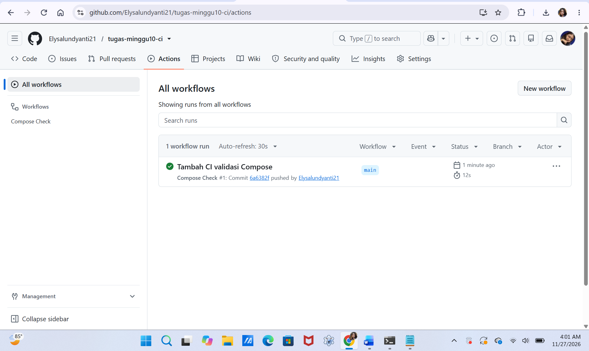
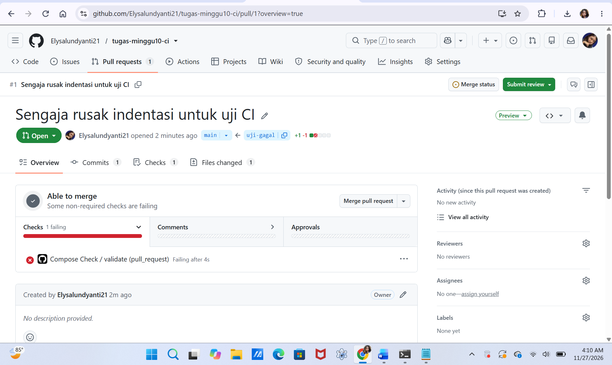
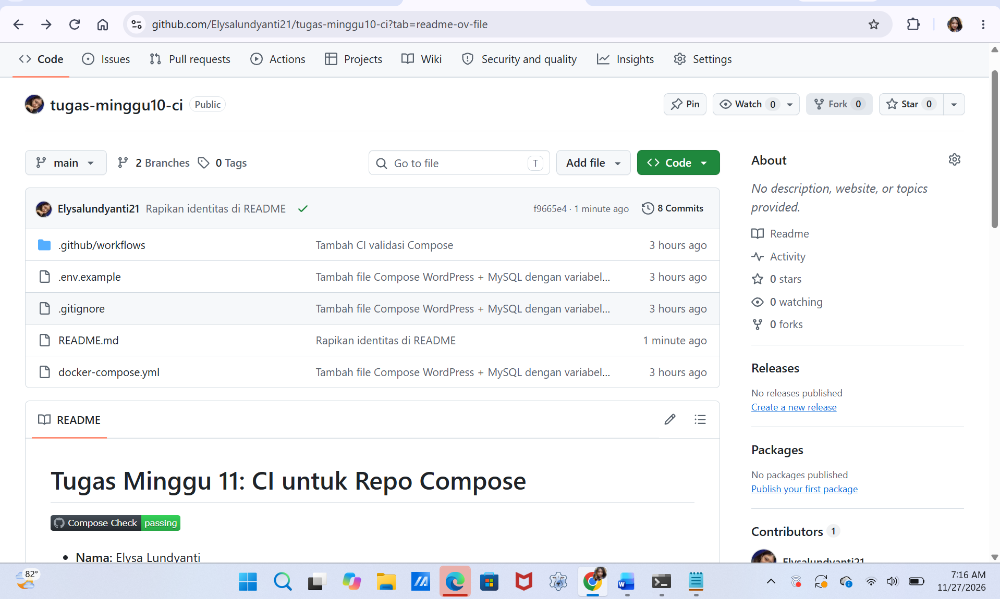

# Tugas Minggu 11: CI untuk Repo Compose

**Nama:** [Elysa Lundyanti]
**NIM:** [202557201014]
**Mata kuliah:** Teknologi Open Source

## Deskripsi
Workflow ini memvalidasi file `docker-compose.yml` (stack WordPress + MySQL dari tugas minggu 10) secara otomatis memakai GitHub Actions. Validasi berjalan setiap ada push ke branch `main` dan setiap ada Pull Request, sehingga kesalahan penulisan file Compose ketahuan sebelum digabung.

## Isi repositori
- .github/workflows/compose-check.yml : workflow CI
- docker-compose.yml : stack WordPress + MySQL (tugas minggu 10)
- .env.example : contoh variabel lingkungan tanpa rahasia asli
- .gitignore : mengabaikan .env

## Cara kerja workflow
Workflow dipicu oleh dua event: `push` ke branch `main` dan `pull_request`. Di dalamnya ada satu job bernama `validate` yang berjalan di runner `ubuntu-latest` (mesin Ubuntu sementara milik GitHub). Job ini punya tiga step yang berjalan berurutan:
1. `actions/checkout@v6` mengambil kode repo ke runner, karena runner awalnya kosong.
2. `cp .env.example .env` membuat file `.env` dari contoh. Langkah ini perlu karena `.env` asli sengaja tidak ada di repo demi keamanan, padahal file Compose membaca variabel dari `.env`.
3. `docker compose config -q` memeriksa sintaks dan isi file Compose tanpa menjalankan container. Kalau file valid, tidak ada output dan step hijau. Kalau ada kesalahan, step gagal (merah).

## Bukti
1. Run hijau di tab Actions

2. Pull Request dengan check gagal (merah)

3. Badge status di README

Tautan Pull Request (sudah hijau dan di-merge): https://github.com/Elysalundyanti21/tugas-minggu10-ci/pull/1

## Kendala dan cara mengatasinya
Saat Pull Request `uji-gagal` dibuka, check berwarna merah di step "Validasi file compose". Di log muncul pesan error: `[yaml: line 4, column 19: mapping values are not allowed in this context]`. Penyebabnya karena spasi baris pada `image:` yang sengaja saya rusak atau saya kurangi satu spasi sehingga YAML tidak valid. Saya memperbaikinya dengan mengembalikan spasi baris seperti semula, commit, lalu push lagi ke branch yang sama. Setelah itu check pada PR berubah hijau dan PR bisa di-merge.

## Refleksi singkat
Dengan CI, kesalahan di file Compose ketahuan beberapa menit setelah push, bukan saat saya menjalankan stack-nya nanti. Hasil hijau atau merah juga terlihat jelas di Pull Request, jadi perubahan yang rusak tidak sengaja ter-merge ke `main`. Ini membuat saya lebih percaya diri saat mengubah konfigurasi.
